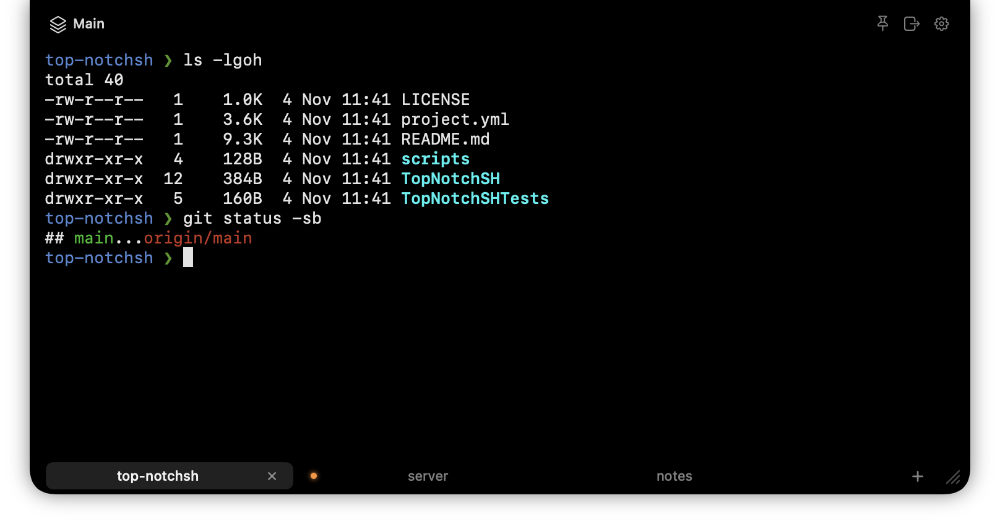
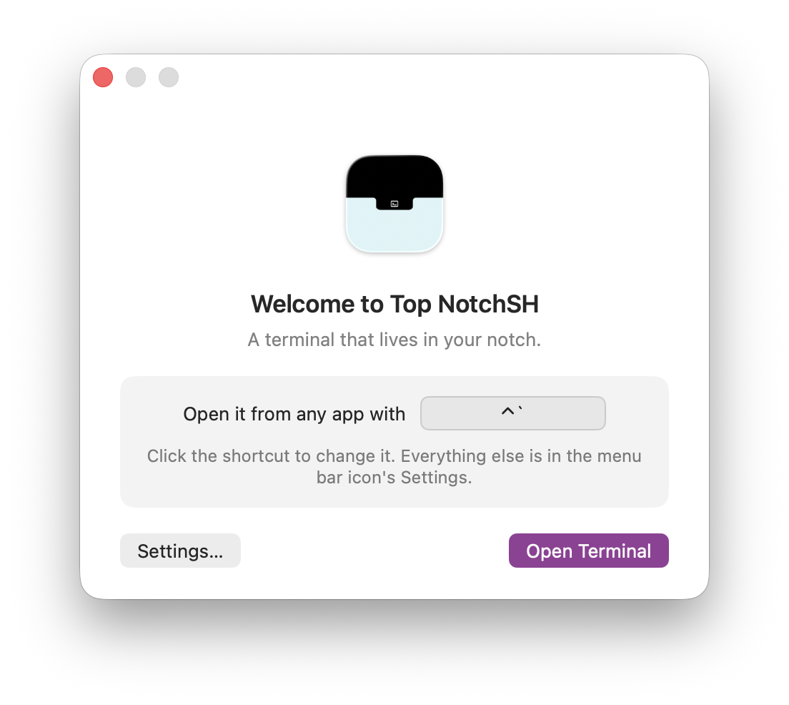
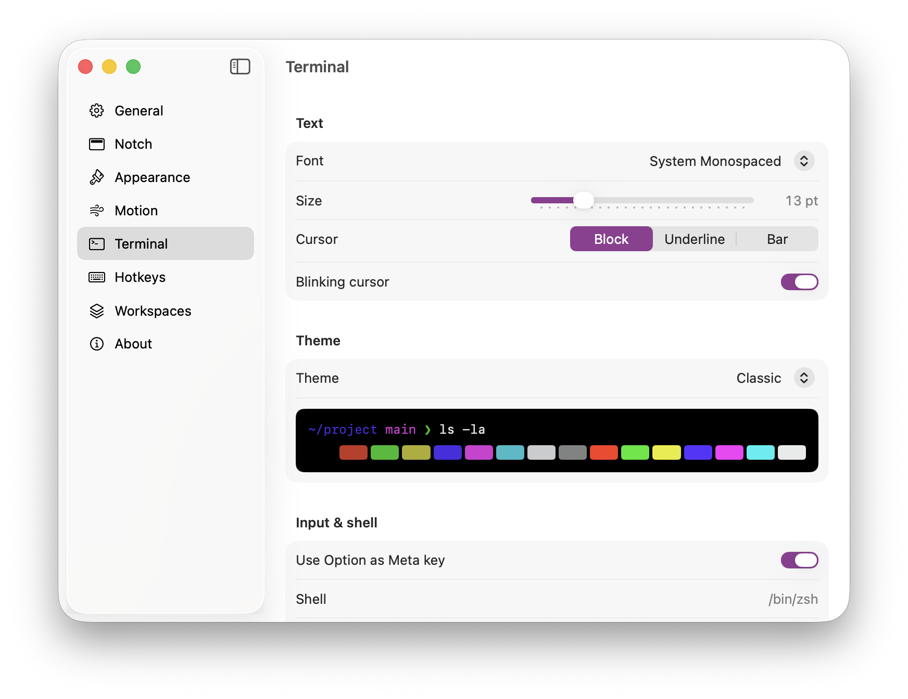

# Top NotchSH

A terminal that lives in your Mac's notch. Press a shortcut from any app and a terminal drops down from the top of the screen. Press it again and it's gone.

<p align="center">
  
</p>

## Install

You need a Mac with Apple silicon (M1 or newer) running macOS 14 Sonoma or later.

1. Download the latest `TopNotchSH-<version>.dmg` from the [Releases page](https://github.com/harvmaster/top-notchsh/releases/latest).
2. Open it and drag **Top NotchSH** into **Applications**.
3. Open Top NotchSH from Applications.
4. The welcome window shows the shortcut that opens the terminal. Press it to try it out.

The default shortcut is **⌃\`** (Control and the key above Tab). You can change it in the welcome window or in Settings.

<p align="center">
  
</p>

## How it works

- **Open and close** the terminal with your shortcut, or click the notch.
- **It closes by itself** when you click into another app. Click the pin in the top-right corner to keep it open.
- **Settings** are in the menu bar icon (the terminal symbol near the clock).
- **Works without a notch.** On other screens, it drops down from the middle of the menu bar.

Everything else works like a normal terminal: it runs your usual shell (zsh by default) with your own setup.

## Features

- **Tabs.** Open as many as you like, drag to reorder them, and double-click to rename one. Tabs come back in the same folders after a restart.
- **Workspaces.** Group tabs into workspaces (for example "Work" and "Personal") and switch between them. A workspace can open in a set folder or run a command when a tab opens, like `ssh my-server`.
- **Alerts.** When a tab you're not looking at rings the bell or finishes a long command, the notch shows a small light so you know to check it.

  

- **Find** text with ⌘F.
- **Drop files** onto the terminal to paste their paths.
- **Pop a tab out** into its own window.
- **Make it yours.** Themes, fonts, cursor style, size, padding, see-through background, animation speed, and every shortcut.
- **Hide it from screen sharing** when you don't want your terminal on a call. Turn it on from the menu bar icon.
- **Updates itself.** You choose whether it asks first, installs automatically, installs only when you're not using it, or only checks when you ask.

<p align="center">
  
</p>

## Keyboard shortcuts

| Shortcut | What it does |
| --- | --- |
| ⌃\` | Open or close the terminal (from any app) |
| ⌘T / ⌘W | New tab / close tab |
| ⌘⇧T | Reopen the last closed tab |
| ⌘1 … ⌘9 | Go to a tab |
| ⌘⇧] / ⌘⇧[ | Next / previous tab |
| ⌘⇧↓ / ⌘⇧↑ | Next / previous workspace |
| ⌘⇧P | Pin the terminal open |
| ⌘D | Move the tab into its own window |
| ⌘F | Find (⌘G / ⌘⇧G for next / previous) |
| ⌘= / ⌘- / ⌘0 | Bigger / smaller / normal text |
| ⌘⇧1 / 2 / 3 | Small / medium / large size |
| ⌘R | Fix a terminal that's acting strangely (see below) |
| ⌘← / ⌘→ | Jump to the start / end of the line |
| ⌥← / ⌥→ | Jump one word left / right |
| ⌘⌫ | Delete the whole line |
| ⌘L | Clear the screen |

You can change any of these in **Settings → Hotkeys**.

## Settings files

Your settings are saved as plain text files in `~/.config/top-notchsh/`:

- `settings.json`: all settings and shortcuts
- `workspaces.json`: your workspaces and tabs
- `displays.json`: which workspace each screen shows

You can edit `settings.json` by hand, and changes apply straight away. Anything you leave out uses the default. If you save a mistake while the app is running, it keeps your last working settings until you fix it. If it can't read the file when it starts, it renames it to `settings.json.invalid` and starts with the defaults.

## Updates

Top NotchSH checks for new versions here on GitHub. Choose what happens in **Settings → General → Updates**:

- **Ask before updating** (the default)
- **Install automatically.** This restarts the app, which stops anything running in it.
- **Install automatically when idle.** Waits until every terminal is at its prompt and you haven't typed for two minutes.
- **Check manually.** Use **Check for Updates…** in the menu bar icon.

Your tabs reopen in their folders after an update.

## Troubleshooting

**The shortcut doesn't do anything.**
Another app, or macOS itself, might be using it. Top NotchSH warns you in Settings → Hotkeys when it can tell. Pick a different shortcut there.

**Moving the mouse prints strange characters, or the arrow keys stop working.**
A program probably closed without tidying up. Press **⌘R** to put the terminal back to normal. Your shell and its history are untouched.

**A command says it isn't allowed to control another app, or to use the camera or microphone.**
macOS asks permission for Top NotchSH on behalf of the commands you run. Allow it in the prompt, or later in **System Settings → Privacy & Security**.

**The last line of text is hidden at the bottom.**
Increase the bottom padding in **Settings → Notch**. Built-in and external screens have separate settings.

## Uninstall

1. Quit Top NotchSH from the menu bar icon.
2. Drag it from Applications to the Bin (Trash).
3. To remove your settings too, delete the `~/.config/top-notchsh` folder.

## Support

If Top NotchSH saves you time, you can [buy me a coffee on Ko-fi](https://ko-fi.com/harvmaster).

---

## Contributing

Bug reports, ideas and pull requests are welcome. Please open an issue first for big changes, so we can talk about the approach.

### Building from source

You need Xcode 16 or newer and [XcodeGen](https://github.com/yonaskolb/XcodeGen) (`brew install xcodegen`).

```bash
git clone https://github.com/harvmaster/top-notchsh.git
cd top-notchsh
xcodegen generate
open TopNotchSH.xcodeproj
```

The first time you build, Xcode asks you to trust SwiftTerm's build plugin. From the command line, pass `-skipPackagePluginValidation` instead:

```bash
xcodebuild -project TopNotchSH.xcodeproj -scheme TopNotchSH -skipPackagePluginValidation build
```

Development builds use the same settings folder as the release app. To keep them apart, set `TOPNOTCHSH_CONFIG_DIR` to another folder.

### Tests

```bash
# Unit tests
xcodebuild -project TopNotchSH.xcodeproj -scheme TopNotchSH -skipPackagePluginValidation test

# End-to-end check: drives the real app, then writes report.txt and screenshots.
# It takes over the keyboard for about a minute and uses a throwaway settings folder.
"<built app>/Contents/MacOS/Top NotchSH" --self-test /tmp/top-notchsh-check
```

The end-to-end check only exists in Debug builds. Add `--memory` to measure memory use, or `--screenshots` to retake the README images.

### How the code is organised

| Folder | What's in it |
| --- | --- |
| `App` | Starting the app and wiring everything together |
| `Notch` | The notch window, its animation, and one controller per screen |
| `Terminal` | Each terminal tab: the shell process, keys and scrolling |
| `Workspaces` | Tabs and workspaces, and saving them |
| `Input` | Shortcuts and the commands they trigger |
| `Settings`, `SettingsUI` | The settings model and the Settings window |
| `Updates` | Automatic updates (Sparkle) |
| `Windows` | Settings, welcome and pop-out windows |

Every action, whether from a shortcut, the menu or a button, is a `Command`, and `NotchCoordinator` carries them all out. All settings are one `Codable` value saved to `settings.json`.

Built with [SwiftTerm](https://github.com/migueldeicaza/SwiftTerm) and [Sparkle](https://sparkle-project.org).

### Making a release (maintainers)

1. Set `MARKETING_VERSION` in `project.yml`.
2. Run `./scripts/release.sh`. It builds, signs, notarizes, and writes `dist/TopNotchSH-<version>.dmg` and `dist/appcast.xml`.
3. Create a GitHub release tagged `v<version>` and attach both files. Installed copies find the update through the attached `appcast.xml`.

Keep `dist/appcast.xml` between releases, because each release adds to it. `./scripts/release.sh --help` lists the options.

One-time setup on a new Mac:

- A **Developer ID Application** certificate: Xcode → Settings → Accounts → Manage Certificates → **+**.
- Notarization login, saved in the Keychain: `xcrun notarytool store-credentials top-notchsh --apple-id <you> --team-id <TEAMID>`.
- The **Sparkle update key**, which must be in the Keychain under the name `top-notchsh`. Back it up: without it, installed copies can never be updated again. To export it, run `generate_keys --account top-notchsh -x <file>`, and keep the file outside the repo. To import it on another Mac, run `generate_keys --account top-notchsh -f <file>`. The tool is in `build/release/derived/SourcePackages/artifacts/sparkle/Sparkle/bin/` after a release build.

## To do

- Split panes (several terminals side by side in one tab)
- Import colour themes from iTerm2 and Ghostty
- Test with more than one screen, and on macOS 14 and 15
- Show release notes in the update window
- A Homebrew cask (`brew install --cask top-notchsh`)

## License

[MIT](LICENSE) © Harvey Zuccon
